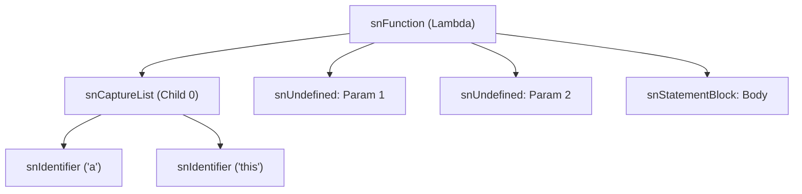

# Phase 2 Analysis & Findings: Parser and AST for Lambdas with Captures

**Document Status**: Complete & Verified (Read-Only Analysis)  
**Target Goal**: Parse `function[captures](params) { body }`, carry capture list through AST (`snCaptureList`), record capture identifiers upon lambda registration, reject unsupported capture modes with dedicated syntax errors, and temporarily reject non-empty captures in the compiler with a clear diagnostic while preserving 100% backward compatibility for existing lambdas and empty capture lists `function[](params) { body }`.

---

## 1. Existing Lambda Detection & Lookahead Extension

### 1.1 Existing Implementation
- **Detection Method**: `asCParser::IsLambda()` at [`as_parser.cpp:1948-1972`](file:///e:/Github/src/angelscript/sdk/angelscript/source/as_parser.cpp#L1948-L1972).
- **Single Invocation Site**: [`as_parser.cpp:1830`](file:///e:/Github/src/angelscript/sdk/angelscript/source/as_parser.cpp#L1830) inside `ParseExprValue()`.
- **Current Lookahead Algorithm**:
  ```cpp
  bool asCParser::IsLambda()
  {
      bool isLambda = false;
      sToken t;
      GetToken(&t);
      if( t.type == ttIdentifier && IdentifierIs(t, FUNCTION_TOKEN) )
      {
          sToken t2;
          GetToken(&t2);
          if( t2.type == ttOpenParenthesis)
          {
              while( t2.type != ttCloseParenthesis && t2.type != ttEnd )
                  GetToken(&t2);
              GetToken(&t2);
              if( t2.type == ttStartStatementBlock )
                  isLambda = true;
          }
      }
      RewindTo(&t);
      return isLambda;
  }
  ```

### 1.2 The Extended Lookahead (`function[` disambiguation)
To support `function[captures](params) { body }` without false positives or performance degradation:
1. When `t` is `ttIdentifier` and `IdentifierIs(t, FUNCTION_TOKEN)`:
   - Check `t2`:
     - If `t2.type == ttOpenBracket` (`[`):
       - Walk tokens tracking balanced brackets (`[` increases nesting, `]` decreases).
       - If it encounters `ttEnd` or `ttEndStatement` (`;`) before closing all brackets, abort (not a lambda).
       - Immediately following the closing `]`, the next token **must be `ttOpenParenthesis` (`(`)**.
         - *Why this prevents false positives*: A variable named `function` indexed as an array, e.g. `function[0] = 10;` or `foo(function[idx]);`, has `=` or `;` or `,` after `]`. In the case of an array of function pointers `function[0](arg);`, the token following `)` is `;` or an operator, never `{`.
     - If after `]` (or directly after `function`) we have `ttOpenParenthesis` (`(`):
       - Walk tokens tracking balanced parentheses until matching `)`.
       - If it encounters `ttEnd` or `ttEndStatement` (`;`), abort.
       - Immediately following `)`, the next token **must be `ttStartStatementBlock` (`{`)**.
         - If true, `isLambda = true`.
2. Always `RewindTo(&t)` at the end.
3. **Performance Impact**: At most a dozen token inspections for lambdas, exactly 1 extra token inspection for normal variables named `function`. O(1) extra cost, zero heap allocations.

---

## 2. Current Lambda AST Node Shape and Consumers

### 2.1 Current Node Shape
In [`as_parser.cpp:2015-2093`](file:///e:/Github/src/angelscript/sdk/angelscript/source/as_parser.cpp#L2015-L2093):
- Root node: `node = CreateNode(snFunction)`.
- Children added in order:
  - 0 or more parameter nodes of type `snUndefined` (`node->AddChildLast(param)` at line 2044).
    - Inside each `param`: optional `snDataType`, optional type modifier, optional `snIdentifier`.
  - 1 statement block node of type `snStatementBlock` (`node->AddChildLast(SuperficiallyParseStatementBlock())` at line 2090).

### 2.2 Exhaustive List of Consumers
There are exactly **three** consumers of the children of a lambda `snFunction` node across the entire codebase:

1. **`asCCompiler::BuildLambdaSignature(asCScriptNode* node)`** ([`as_compiler.cpp:7788-7830`](file:///e:/Github/src/angelscript/sdk/angelscript/source/as_compiler.cpp#L7788-L7830)):
   ```cpp
   asCScriptNode* argNode = node->firstChild;
   while (argNode->nodeType != snStatementBlock)
   {
       if (argNode->nodeType == snUndefined)
       {
           // Inspects typeNode, pushes to lambdaParamTypes
       }
       argNode = argNode->next;
   }
   ```
2. **`asCCompiler::ImplicitConvLambdaToFunc(...)`** ([`as_compiler.cpp:7832-7902`](file:///e:/Github/src/angelscript/sdk/angelscript/source/as_compiler.cpp#L7832-L7902)):
   ```cpp
   asUINT count = 0;
   asCScriptNode *argNode = ctx->exprNode->firstChild;
   while( argNode->nodeType != snStatementBlock )
   {
       if (argNode->nodeType == snUndefined)
       {
           // Validates parameter match, count++
       }
       argNode = argNode->next;
   }
   asASSERT(argNode->nodeType == snStatementBlock);
   ```
3. **`asCBuilder::RegisterLambda(...)`** ([`as_builder.cpp:5224-5260`](file:///e:/Github/src/angelscript/sdk/angelscript/source/as_builder.cpp#L5224-L5260)):
   ```cpp
   asCScriptNode *args = node->firstChild;
   while( args && args->nodeType != snStatementBlock )
   {
       if (args->nodeType == snUndefined)
       {
           // Extracts parameter name
       }
       args = args->next;
   }
   args->DisconnectParent(); // Disconnects snStatementBlock for compilation
   ```

**Crucial Invariant Observed**:
All three consumers iterate until `nodeType == snStatementBlock` and process **only** nodes where `nodeType == snUndefined`. Any other node type before `snStatementBlock` is skipped transparently!

---

## 3. AST Design: Child Placement and Node Structure

### 3.1 Node Definition
Add a new enum to `eScriptNode` in [`as_scriptnode.h:47-98`](file:///e:/Github/src/angelscript/sdk/angelscript/source/as_scriptnode.h#L47-L98):
```cpp
enum eScriptNode
{
    ...
    snTryCatch,
    snCaptureList // New: holds captured variables for lambda expressions
};
```

### 3.2 Child Ordering in `snFunction`
When a lambda has a capture clause `function[...]`:
- **Child 0**: `snCaptureList`
  - Children of `snCaptureList`: 0 or more `snIdentifier` nodes representing each capture.
- **Children 1..N**: Parameter nodes (`snUndefined`)
- **Child N+1**: `snStatementBlock`



### 3.3 Compatibility Proof
- **Lambdas without `[...]` (today's syntax)**:
  - Do NOT create `snCaptureList`.
  - Child 0 remains the first `snUndefined` parameter (or `snStatementBlock` if 0 params).
  - Exact binary and semantic identity with current codebase.
- **Lambdas with `function[]` (empty captures)**:
  - `snCaptureList` is created with 0 children (`firstChild == 0`).
  - Consumers 1, 2, 3 encounter `snCaptureList`, verify `nodeType != snUndefined`, advance to `next`, and process parameters identically.
  - When reaching `snStatementBlock`, `args->DisconnectParent()` in `RegisterLambda` unlinks only `snStatementBlock`.
  - 100% backward compatible execution.
- **Lambdas with `function[a, b, this]` (non-empty captures)**:
  - In Phase 2: validated by parser, stored by builder, and rejected by compiler in `ImplicitConvLambdaToFunc` with `TXT_CAPTURE_LISTS_NOT_IMPLEMENTED_YET`.

---

## 4. Grammar, Tokenizer Interactions, and Diagnostics

### 4.1 Extended Grammar
```bnf
LAMBDA       ::= 'function' [ CAPTURELIST ] '(' PARAMLIST? ')' STATBLOCK
CAPTURELIST  ::= '[' [ CAPTURE (',' CAPTURE)* ] ']'
CAPTURE      ::= IDENTIFIER | 'this'
```

### 4.2 Tokenizer Analysis
- `[` is `ttOpenBracket` ([`as_tokendef.h:107, 240`](file:///e:/Github/src/angelscript/sdk/angelscript/source/as_tokendef.h#L107)).
- `]` is `ttCloseBracket` ([`as_tokendef.h:108, 241`](file:///e:/Github/src/angelscript/sdk/angelscript/source/as_tokendef.h#L108)).
- `&` is `ttAmp` ([`as_tokendef.h:109, 244`](file:///e:/Github/src/angelscript/sdk/angelscript/source/as_tokendef.h#L109)).
- `=` is `ttAssignment` ([`as_tokendef.h:100, 242`](file:///e:/Github/src/angelscript/sdk/angelscript/source/as_tokendef.h#L100)).
- `this` is a contextual keyword identifier ([`as_tokendef.h:315`](file:///e:/Github/src/angelscript/sdk/angelscript/source/as_tokendef.h#L315), `THIS_TOKEN`).
- There are no multi-character bracket tokens (`[&` and `[=` are tokenized as separate tokens: bracket then amp/equal).
- `asCParser::GetToken()` ([`as_parser.cpp:1014`](file:///e:/Github/src/angelscript/sdk/angelscript/source/as_parser.cpp#L1014)) automatically skips whitespace and comments (`ttWhiteSpace`, `ttOnelineComment`, `ttMultilineComment`). Spaces/newlines/comments anywhere within `function [ /*cap*/ a , this ] ( ) { }` are handled transparently.

### 4.3 Diagnostics for Rejected Syntax
All errors use dedicated text defines in `as_texts.h` and report exact source token positions (`row`/`col`):

| Syntax Pattern | Rejection Point | Error Diagnostic | Text Constant |
|---|---|---|---|
| `function[&x]` | Parser (`ParseLambda`) | `"Capture by reference is not supported yet"` | `TXT_CAPTURE_BY_REF_NOT_SUPPORTED` |
| `function[&]` | Parser (`ParseLambda`) | `"Default capture is not supported yet"` | `TXT_DEFAULT_CAPTURE_NOT_SUPPORTED` |
| `function[=]` | Parser (`ParseLambda`) | `"Default capture is not supported yet"` | `TXT_DEFAULT_CAPTURE_NOT_SUPPORTED` |
| `function[a, a]` | Parser (`ParseLambda`) | `"Duplicate capture variable 'a'"` | `TXT_DUPLICATE_CAPTURE_s` |
| `function[this, this]` | Parser (`ParseLambda`) | `"Duplicate capture 'this'"` | `TXT_DUPLICATE_CAPTURE_THIS` |
| `function[x](int x)` | Parser (`ParseLambda`) | `"Capture variable 'x' conflicts with lambda parameter"` | `TXT_CAPTURE_CONFLICTS_WITH_PARAM_s` |
| `function[a, ]` / `function[,]` | Parser (`ParseLambda`) | `"Expected capture identifier or 'this'"` | `TXT_EXPECTED_CAPTURE_VAR` |
| `function(,)` / `function(int a,)` | Parser (`ParseLambda`) | `"Empty lambda parameter is not allowed"` | `TXT_EMPTY_LAMBDA_PARAMETER` |
| Non-empty captures in Phase 2: `function[a]() {}` | Compiler (`ImplicitConvLambdaToFunc`) | `"Capture lists are not implemented yet"` | `TXT_CAPTURE_LISTS_NOT_IMPLEMENTED_YET` |

---

## 5. Builder Pre-Registration & Capture Propagation

### 5.1 Lambda Discovery & Compilation Flow
1. While compiling a function (`asCBuilder::CompileFunctions` in [`as_builder.cpp:610-618`](file:///e:/Github/src/angelscript/sdk/angelscript/source/as_builder.cpp#L610-L618)), the compiler parses expressions.
2. When a lambda is assigned to a funcdef, `ImplicitConvLambdaToFunc` calls:
   [`builder->RegisterLambda(ctx->exprNode, script, funcDef, name, outFunc->nameSpace, outFunc->IsShared())`](file:///e:/Github/src/angelscript/sdk/angelscript/source/as_compiler.cpp#L7893).
3. `RegisterLambda` ([`as_builder.cpp:5224`](file:///e:/Github/src/angelscript/sdk/angelscript/source/as_builder.cpp#L5224)) creates an `asCScriptFunction` and appends it to `builder->functions`.
4. Because the loop `for( asUINT n = 0; n < functions.GetLength(); n++ )` evaluates `GetLength()` dynamically, newly registered lambdas are compiled in later iterations.

### 5.2 Propagating Capture Identifiers
In `asCScriptFunction` ([`as_scriptfunction.h:323-334`](file:///e:/Github/src/angelscript/sdk/angelscript/source/as_scriptfunction.h#L323-L334)):
- Add member: `asCArray<asCString> captureNames;`
- In `asCBuilder::RegisterLambda`:
  If `node->firstChild && node->firstChild->nodeType == snCaptureList`:
  Extract each `snIdentifier` text from `node->firstChild` and assign to `func->captureNames`.
- This ensures the captured names are persisted on the script function object for Phase 3 (scope checking) and Phase 4 (delegate/closure code generation).

---

## 6. Phase 2 Implementation Roadmap
1. `as_scriptnode.h`: Add `snCaptureList` to `eScriptNode`.
2. `as_texts.h`: Add diagnostics for capture-related syntax errors and temporary compiler limitation.
3. `as_parser.h` / `as_parser.cpp`:
   - Extend `IsLambda()` lookahead to support `function[...]`.
   - Update `ParseLambda()` to parse `snCaptureList`, validate against rejected forms, enforce parameter-capture distinctness, and report exact token source positions.
4. `as_scriptfunction.h` / `as_scriptfunction.cpp`: Add `captureNames` array to `asCScriptFunction`.
5. `as_builder.cpp`: In `RegisterLambda`, copy capture names from `snCaptureList` to the newly created `asCScriptFunction`.
6. `as_compiler.cpp`: In `ImplicitConvLambdaToFunc`, check if `snCaptureList` is non-empty; if so, emit `TXT_CAPTURE_LISTS_NOT_IMPLEMENTED_YET`. If empty (`function[]`), compile normally.
7. `test_lambda.cpp`: Add comprehensive unit test suite covering valid capture parsing, error diagnostics for each rejected form, empty capture execution, fuzz/malformed strings, and zero-regression verification.
